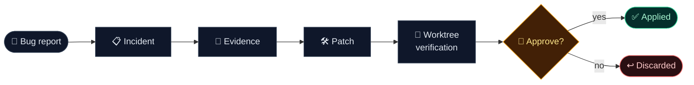
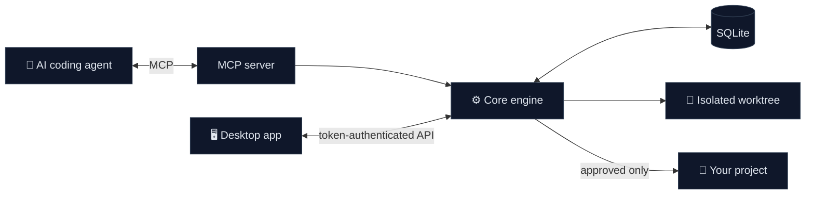

<div align="center">


<br />

[](./LICENSE)


### Stop guessing. Prove the fix. Approve what lands.

Agent Autopsy sits between your AI coding agent and your code.<br />
It turns bug reports into incidents, verifies every patch in isolation,<br />
and lets **only human-approved changes** reach your working tree.

[Features](#-features) · [How it works](#-how-it-works) · [Quick start](#-quick-start) · [Roadmap](#-roadmap)

</div>

<br />

## ✨ Features

<table>
  <tr>
    <td width="33%" valign="top">
      <h3>🔬 Evidence first</h3>
      Bug reports become tracked incidents with test results and error context, so fixes start from facts instead of guesses.
    </td>
    <td width="33%" valign="top">
      <h3>🧪 Isolated verification</h3>
      Every patch is tested in a separate git worktree before it can touch your real files.
    </td>
    <td width="33%" valign="top">
      <h3>🔐 Human approval gate</h3>
      Agents can only propose. Approving a patch takes a click in the desktop app, backed by a session token the agent never sees.
    </td>
  </tr>
  <tr>
    <td width="33%" valign="top">
      <h3>🛡️ Tamper detection</h3>
      Approvals are signed and re-checked at apply time. Edited databases, swapped patches, and faked test commands are caught and blocked.
    </td>
    <td width="33%" valign="top">
      <h3>🌐 Any language</h3>
      Runs your project's own tests: <code>pytest</code>, <code>unittest</code>, <code>ctest</code>, <code>go test</code>, <code>cargo test</code>, npm scripts, and more.
    </td>
    <td width="33%" valign="top">
      <h3>🧩 Works with your agent</h3>
      Plugs into Antigravity, Claude Code, Codex, and other MCP clients. No extra model or API key.
    </td>
  </tr>
</table>

## 🔁 How it works



<details>
<summary><b>Architecture</b></summary>
<br />



Everything runs locally. No cloud service is involved.

</details>

## 🚀 Quick start

**Requirements:** Node.js 22.5+ · pnpm · Git 2.40+ · Windows (desktop app)

```bash
git clone https://github.com/kimchi00100/agent-autopsy.git
cd agent-autopsy
pnpm install
pnpm run build

pnpm run desktop      # run the desktop app
pnpm run build:exe    # package a standalone Windows build
```

<details>
<summary><b>Connect your agent (MCP)</b></summary>
<br />

Add this to your agent's MCP configuration:

```json
{
  "mcpServers": {
    "agent-autopsy": {
      "command": "node",
      "args": ["<install path>/packages/mcp-server/dist/index.js"]
    }
  }
}
```

Then open your project in the desktop app and confirm its test command once.

</details>

## 🗺️ Roadmap

- [x] Shared local data store for the app and MCP server
- [x] Signed approvals and tamper detection
- [x] User-confirmed test commands with multi-language detection
- [ ] Evidence-based cause and risk scoring
- [ ] Language-agnostic evidence collector (stack locations, repro tests, coverage)
- [ ] Incident history tools and guided next steps for agents
- [ ] Faster desktop dashboard

## 🧰 Tech stack


## 👤 Developer

<table>
  <tr>
    <td align="center" width="140">
      
    </td>
    <td valign="middle">
      <b>kimchi00100</b><br /><br />
      <a href="https://github.com/kimchi00100"></a><br />
      
    </td>
  </tr>
</table>

## 📄 License

Released under the [MIT License](./LICENSE).
