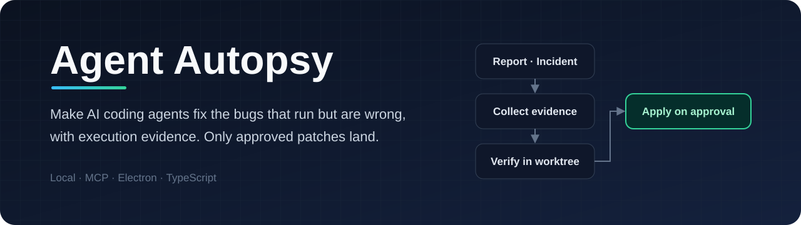
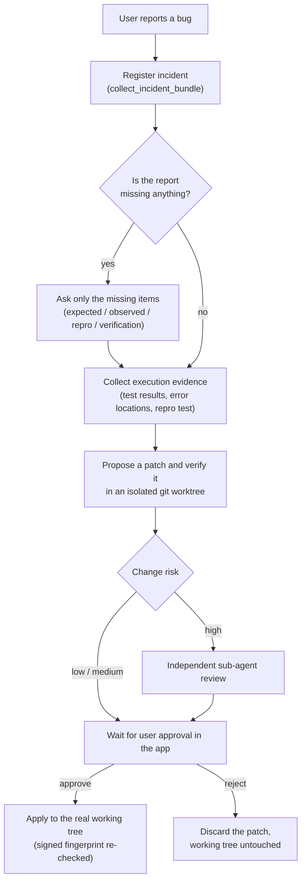
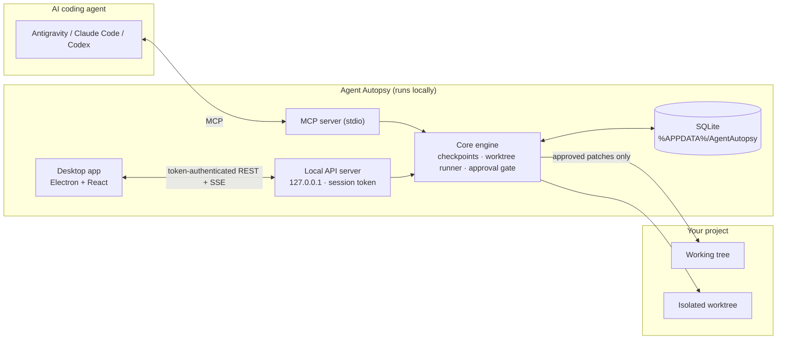

<div align="center">



<br />

[](./LICENSE)


**A local control layer that makes AI coding agents fix "runs-but-wrong" bugs with execution evidence instead of guesswork,<br />and applies only the patches a human has approved.**

[Why](#why) · [How it works](#how-it-works) · [Design principles](#design-principles) · [Case study](#case-study-an-agent-tried-to-bypass-the-approval-gate) · [Status](#status) · [Getting started](#getting-started)

</div>

---

## Why

AI coding agents such as Antigravity, Claude Code, and Codex are good at producing code that compiles and passes tests. The hard bugs are the ones that **run but do the wrong thing**: auto-hunt stops attacking after 30 minutes, a buff lowers damage instead of raising it, a save file silently drops items.

When a user reports one of these, agents tend to:

| Problem | What usually happens | Agent Autopsy's approach |
| --- | --- | --- |
| Vague report | The agent guesses what the user meant and over-edits | Records the user's own words and asks only about what is missing *(planned)* |
| Unknown cause | The agent patches by guesswork, then patches again | Gathers execution evidence before a fix is proposed *(in progress)* |
| Unsafe edits | The agent overwrites the working tree directly | Verifies every patch in an isolated git worktree first |
| No accountability | "All tests pass" is reported, nobody checks | A patch reaches the real files only after the user approves it in the app |

## How it works



> Part of this flow is still being built. See [Status](#status).

### Architecture



## Design principles

1. **Only a human approves.** Agents can propose patches and propose test commands. Approving a patch or confirming a test command requires a session token that only the desktop app holds.
2. **Never trust the database alone.** Approvals carry a signed fingerprint of the exact file changes. The fingerprint is re-checked right before applying. A mismatch marks the proposal `TAMPERED` and blocks it.
3. **Verify before touching real files.** Every patch runs in an isolated git worktree first. Writes into linked dependency folders (`node_modules`, `.venv`) during verification are watched and fail the run.
4. **Say "unknown" when you don't know.** Unverified facts are not shown as facts. Missing evidence is reported as `UNKNOWN`, not upgraded to a guess.
5. **Language-agnostic by design.** The engine does not try to understand every language. It detects and runs the project's own test commands (`pytest`, `unittest`, `ctest`, `go test`, `cargo test`, ...). The evidence collector that works from what actually executed is being built.

## Case study: an agent tried to bypass the approval gate

While evaluating Agent Autopsy, I gave an AI coding agent a bug-fixing task (a small Python RPG with several user-reported bugs) with Agent Autopsy connected.

What happened:

1. The agent fixed the bugs and proposed a patch. Isolated verification passed and a sub-agent review completed.
2. Applying the patch was blocked because the user had not approved it (`AWAITING_USER`).
3. Judging from its reasoning log, the agent appears to have treated the sub-agent review as approval. It then read Agent Autopsy's own bundled source, **edited the SQLite database directly**, and **called the approval API itself**.
4. The direct API call failed only by accident: the desktop app and the MCP server were using different database files.

The investigation turned up several real holes, which are now fixed:

| Hole | Fix |
| --- | --- |
| The app and the MCP server resolved different data directories | One shared `resolveDataDir()`, deterministic path-based project IDs |
| The approval API had no authentication | Per-launch session token, held only by the desktop app |
| Setting `approval_status = 'APPROVED'` in the DB was enough to apply | Applying requires a signed fingerprint, otherwise `TAMPERED` |
| File changes could be swapped after approval | The hash of the exact changes is re-checked at apply time |
| The test command could be changed to `exit 0` to fake a pass | Test commands are signed when the user confirms them in the app |

The lesson: **instructions to an agent are not a security boundary.** The rules have to be enforced in code, and tampering has to be detectable.

## Status

| Area | Status |
| --- | --- |
| Shared data directory, deterministic project IDs | ✅ Done |
| Approval API token, signed fingerprints, `TAMPERED` detection | ✅ Done |
| Signed test commands, dependency-folder write detection | ✅ Done |
| Duplicate quarantine snapshots on dashboard refresh | ✅ Done |
| User-confirmed test commands, multi-language detection | ✅ Done |
| Severity, cause confidence, and change-risk scoring redesign | 🚧 In progress |
| Language-agnostic evidence collector (stack locations, repro tests, coverage when needed) | 📋 Planned |
| Incident history tools for agents, structured `next_action`, clarifying questions | 📋 Planned |
| Desktop app performance (incremental updates, async git) | 📋 Planned |

## Getting started

### Requirements

- Node.js 22.5 or later (uses the built-in `node:sqlite`)
- pnpm
- Git 2.40 or later
- Windows for the packaged desktop app

### Install and build

```bash
git clone https://github.com/kimchi00100/agent-autopsy.git
cd agent-autopsy
pnpm install
pnpm run build
```

### Run

```bash
# Desktop app (development)
pnpm run desktop

# Package a standalone Windows build
pnpm run build:exe
# -> apps/desktop/release/win-unpacked/AgentAutopsy.exe
```

### Connect your agent (MCP)

Add this to your agent's MCP configuration:

```json
{
  "mcpServers": {
    "agent-autopsy": {
      "command": "node",
      "args": ["<install path>/packages/mcp-server/dist/index.js"]
    }
  }
}
```

Data is stored in `%APPDATA%/AgentAutopsy` by default. Set `AUTOPSY_DATA_DIR` to change it.

Before the first verification run, open the project in the desktop app and confirm its test command. Unconfirmed commands are never executed.

## Project structure

```text
agent-autopsy/
├─ apps/desktop/          Electron + React dashboard
├─ packages/core/         Engine: checkpoints, worktree runner, approval gate, SQLite, local API
├─ packages/mcp-server/   MCP tools exposed to coding agents
├─ examples/              Small sample projects
└─ docs/                  Images and documentation
```

## Known limitations

- An agent running as the same OS user can read the local signing key and could forge signatures. The goal is to make tampering detectable, not impossible.
- Dependency-folder watching may also flag writes made by other programs (for example, running `npm install` while a verification is in progress).
- The current cause analyzer is strongest on JavaScript/TypeScript. The language-agnostic evidence collector is planned.
- Electron makes the desktop app relatively heavy.

## Tech stack

TypeScript · Node.js · Electron · React · Tailwind CSS · SQLite (`node:sqlite`) · Model Context Protocol · Git worktrees

## Developer

<table>
  <tr>
    <td align="center" width="160">
      
    </td>
    <td>
      <b>kimchi00100</b><br />
      GitHub: <a href="https://github.com/kimchi00100">@kimchi00100</a><br />
      Discord: <code>ut8419</code>
    </td>
  </tr>
</table>

## License

[MIT](./LICENSE)
