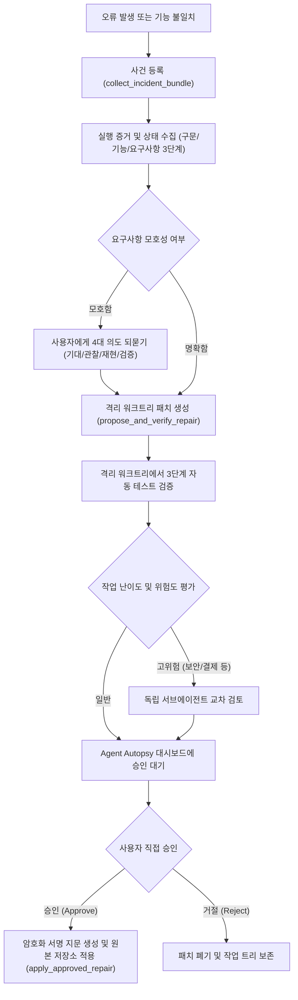
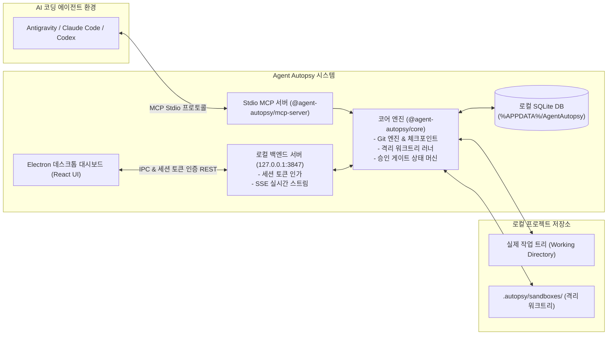

# Agent Autopsy

> **AI 코딩 에이전트가 '돌아가지만 틀린' 버그를 추측 대신 실행 증거로 고치게 하고, 사용자가 승인한 수정만 적용하는 로컬 도구**  
> *A local safety harness ensuring AI coding agents repair semantic bugs with execution evidence rather than guess-work, enforcing human approval before applying patches.*

---

## 1. 왜 만들었나 (Background)

AI 코딩 에이전트(Antigravity, Claude Code, Codex 등)를 사용할 때 다음과 같은 문제를 겪게 됩니다:

1. **'돌아가지만 틀린' 코드**: AI가 작성한 코드가 구문 오류나 테스트는 통과하지만, 사용자가 원래 의도했던 비즈니스 로직이나 요구사항과 다르게 동작합니다.
2. **반복적인 추측 수정**: 문제의 정확한 원인을 확인하지 않고 짐작으로 코드를 고치다가, 기존에 잘 동작하던 다른 코드까지 망가뜨리는 악순환이 발생합니다.
3. **무검증 직접 수정 위험**: AI가 사용자의 작업 트리에 직접 코드를 덮어써서, 실패했을 때 이전 상태로 복구하기 어렵습니다.

**Agent Autopsy**는 AI 에이전트가 실제 작업 트리를 건드리기 전에 **격리된 환경에서 실행 증거로 패치를 먼저 검증**하고, 사용자가 대시보드에서 **명시적으로 승인한 수정만 작업 트리에 반영**하도록 통제하는 로컬 안전 검증 도구입니다.

---

## 2. 작동 흐름 (Workflow)


※ 목표 설계입니다. 서명된 승인 지문, 세션 토큰 인증 등 일부는 로드맵 2번에서 구현 중입니다.

---

## 3. 전체 구조 (Architecture)

Agent Autopsy는 로컬 단독 실행 구조로 동작하며 외부 클라우드 의존성 없이 개발자 PC 내부에서만 완결됩니다.


※ 목표 설계입니다. 서명된 승인 지문, 세션 토큰 인증 등 일부는 로드맵 2번에서 구현 중입니다.

---

## 4. 주요 기능 (Features)

* **비파괴 사전 체크포인트**: Git 커밋 트리를 오염시키지 않고 현재 인덱스와 작업 트리의 스냅샷을 보존하여 언제든 롤백할 수 있습니다.
* **격리 워크트리 패치 사전 검증**: 실제 작업 트리를 복사하지 않고 Git Worktree와 디렉터리 정션을 활용하여 격리 샌드박스를 구성하고 패치를 사전에 테스트합니다.
* **사용자 승인 게이트**: 사용자가 대시보드에서 승인하지 않은 수정안은 로컬 게이트 엔진에 의해 원본 파일 적용이 거부됩니다.

---

## 5. 설치 및 실행 (Installation & Getting Started)

### 사전 요구사항
* **Node.js**: v22.0.0 이상
* **패키지 매니저**: pnpm
* **Git**: v2.40 이상

### 1) 의존성 설치 및 빌드
```bash
# 저장소 복제
git clone https://github.com/kimchi00100/Agent-autopsy.git
cd Agent-autopsy

# 의존성 설치
pnpm install

# 모노레포 전체 빌드
pnpm run build
```

### 2) 개발 모드 실행
```bash
# 데스크톱 앱 및 백엔드 개발 실행
pnpm run desktop
```

### 3) 독립 실행형 Windows EXE 빌드
```bash
# Electron 단독 실행 패키징
pnpm run build:exe
```
* 빌드가 완료되면 `apps/desktop/release/win-unpacked/AgentAutopsy.exe` 파일이 생성됩니다.

---

## 6. MCP (Model Context Protocol) 연결 방법

사용하시는 AI 코딩 에이전트의 MCP 설정 파일에 아래 내용을 추가합니다.

### Antigravity / Claude Desktop 설정 예시
```json
{
  "mcpServers": {
    "agent-autopsy": {
      "command": "node",
      "args": [
        "<설치 경로>/packages/mcp-server/dist/index.js"
      ],
      "env": {
        "AUTOPSY_DATA_DIR": "<데이터 저장 경로 (생략 시 기본 %APPDATA%/AgentAutopsy 사용)>"
      }
    }
  }
}
```

---

## 7. 스크린샷 및 데모 (Screenshots & Demo)

<!-- TODO: docs/images/ 디렉터리에 실제 대시보드 화면 및 격리 워크트리 검증 캡처 추가 예정 -->
*대시보드 주요 화면 및 검증 흐름도 스크린샷이 추가될 예정입니다.*

---

## 8. 알려진 한계 및 로드맵 (Limitations & Roadmap)

Agent Autopsy는 지속적으로 개선 중이며, 다음 작업들이 진행 및 예정되어 있습니다:

1. **앱과 MCP의 데이터 연동 보강**: 앱과 MCP가 다른 DB 경로를 바라보아 사건이 대시보드에 나타나지 않는 문제를 수정하고 데이터 동기화를 단일화하는 작업 진행 중
2. **승인 게이트 보안 보강**: 대시보드 호출 인증 토큰 도입, 서명된 승인 지문 검증, 패치 사후 위변조(Patch Drift) 감지 고도화
3. **언어 무관(Language-Agnostic) 실행 증거 수집기**: 언어를 억지로 이해하려 하지 않고, 테스트 실행 결과, 오류 발생 위치, 재현 테스트 결과, 필요 시 커버리지를 기반으로 증거를 수집하는 범용 분석기 구축
4. **정밀 위험도 판정 기준**: 정규식 기반 단순 키워드 탐색에서 벗어나, 사용자가 지정한 민감 경로 및 실제 변경 줄 수를 기반으로 위험도를 객관적으로 판정

---

## 9. 라이선스 (License)

본 프로젝트는 [MIT License](./LICENSE)에 따라 배포됩니다.
