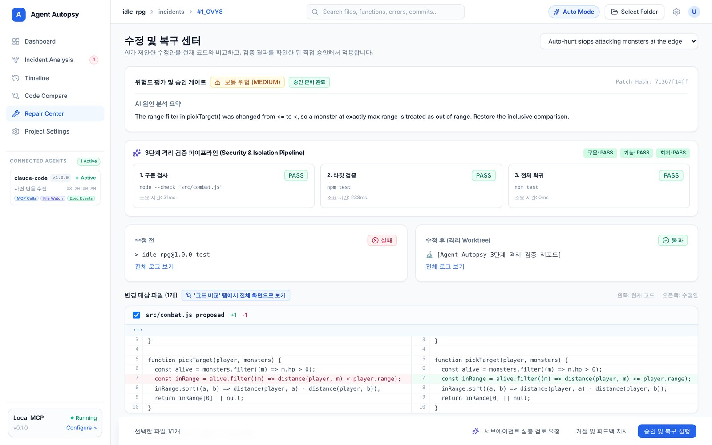
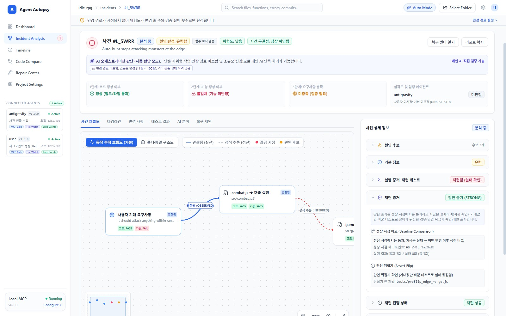
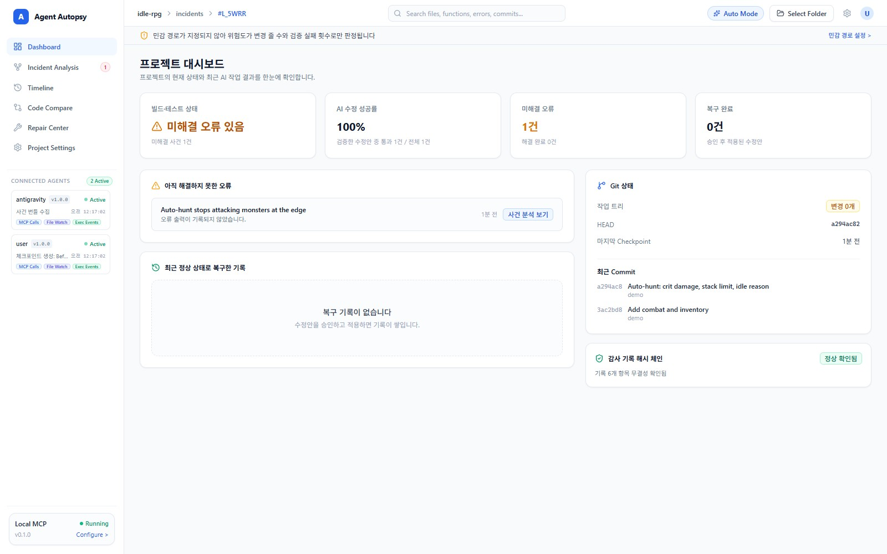

<p align="center">
  <b>English</b> · <a href="./README.ko.md">한국어</a>
</p>

<h1 align="center">Agent Autopsy</h1>

<p align="center">
  <b>Your AI agent proposes. You approve. Nothing else lands.</b>
</p>

<p align="center">
  <a href="docs/screenshots/repair-center.jpeg"></a>
</p>

<p align="center">
  
  
  
  
  
  
  
  
  
  
  
  
  
  
  
  
</p>

<p align="center">
  <a href="#why-agent-autopsy">Why</a> ·
  <a href="#quickstart">Quickstart</a> ·
  <a href="#what-you-get">What you get</a> ·
  <a href="#how-it-works">How it works</a> ·
  <a href="#philosophy--trust-evidence-not-the-agents-word">Philosophy</a> ·
  <a href="#roadmap">Roadmap</a> ·
  <a href="#contact">Contact</a>
</p>

---

## Why Agent Autopsy

> *"All tests pass."* — every coding agent, right before the feature still doesn't work.

AI coding agents are great at code that compiles. The painful bugs are the ones that **run but do the wrong thing**: auto-hunt stops attacking at the edge of its range, a discount subtracts 10 won instead of 10%, a save file quietly drops items.

When you report one, the agent usually guesses, rereads half the repository, patches your files directly, and tells you it is fixed. Agent Autopsy puts a checkpoint in that loop.

| | Asking the agent again | **Agent Autopsy** |
| --- | --- | --- |
| What you reported | Paraphrased by the agent | Your original words, stored next to the agent's reading, with each intent marked as quoted or inferred |
| Where the agent looks first | Wherever it guesses, often the whole repo | The functions changed since the last checkpoint, plus their direct callers and callees |
| Where the fix is tested | In your working tree, if at all | In an isolated git worktree, before anything touches your files |
| What "verified" means | The agent says so | Syntax, target test, and full regression run separately, with logs |
| Who decides | The agent | You, with one click in the desktop app |
| If the patch changes after approval | Nobody notices | The approval carries a signed fingerprint, re-checked before applying; a mismatch is marked `TAMPERED` |

## Quickstart

```bash
# 1. Build
git clone https://github.com/kimchi00100/agent-autopsy.git
cd agent-autopsy
pnpm install
pnpm run build

# 2. Run the desktop app
pnpm run desktop

# 3. Or package a standalone Windows build
pnpm run build:exe   # -> apps/desktop/release/win-unpacked/AgentAutopsy.exe
```

Requires Node.js 22.5+, pnpm, and Git 2.40+. The packaged app targets Windows.

### Connect your agent

Add Agent Autopsy to your agent's MCP config (Antigravity, Claude Code, Codex, or any MCP client):

```json
{
  "mcpServers": {
    "agent-autopsy": {
      "command": "node",
      "args": ["<install path>/packages/mcp-server/dist/index.js"]
    }
  }
}
```

If you use the packaged app, point `args` at `apps/desktop/release/win-unpacked/resources/bundled/mcp-server.cjs` instead. Restart your agent after rebuilding so it picks up new tools.

Then open your project in the desktop app and confirm its test command once. Unconfirmed commands are never run.

## What you get

**Repair Center — review, then approve.** A verified patch with its root-cause summary, three-stage verification results, and a side-by-side diff. Your original report is shown next to the agent's interpretation, with the quoted parts highlighted, so you can check it is really what you asked for. Nothing is applied until you click approve.

**Incident Analysis — see where it broke.** Each bug report becomes an incident with the expected vs. observed behavior, a flow graph that separates observed evidence from inferred links, and the evidence behind every severity and risk label. If part of the report is missing, the agent is told to ask you for that item only.

<p align="center">
  <a href="docs/screenshots/incident-analysis.jpeg"></a>
</p>

**Change Scope — where to look first.** When an incident is registered, the agent immediately gets the functions that changed since the last checkpoint and the functions that call them or are called by them, parsed with tree-sitter for Python, JavaScript/TypeScript, and C/C++. It is a search range, not a ranking and not a verdict: the agent is told to compare these functions with your report before rereading the whole repository.

**Dashboard — the project at a glance.** Build and test status, open incidents, fix success rate, and git state.

<p align="center">
  <a href="docs/screenshots/dashboard.jpeg"></a>
</p>

In benchmark runs ([details](docs/performance.md)), `POST /api/overview` response time with 50 changed files went from 4,351 ms → 199 ms (median of 3 rounds), and git processes spawned while idle for 60 seconds went from 1,104 → 9. Measurement conditions (a single laptop, small sample repositories) are documented in [performance.md](docs/performance.md).

<sub>Screenshots are from a sample project (<code>idle-rpg</code>) and predate the latest updates. The dashboard UI is Korean-first today; full English UI is on the roadmap.</sub>

## How it works

```text
+--------------+   MCP    +---------------------- Agent Autopsy (local) -------+
| Coding agent | -------> |                                                    |
|  (proposes)  |          |   incident --> change scope --> evidence --> patch |
+--------------+          |   (your words)  (since last                 |      |
                          |                  checkpoint)                v      |
                          |                  isolated git worktree             |
                          |       syntax --> target test --> full regression   |
                          |                               |                    |
                          |                               v                    |
+--------------+  token   |                  +-------------------------+       |
| Desktop app  | -------> |                  |      approval gate      |       |
| (you decide) |          |                  |   signed fingerprint    |       |
+--------------+          |                  +------------+------------+       |
                          |                               | approved only      |
                          +-------------------------------|--------------------+
                                                          v
                                                  your working tree
```

- **MCP server** — 18 tools your agent calls: checkpoints, incidents, change scope, reproduction runs, patch proposals and verification, incident history, and structured `next_action` guidance in every response.
- **Core engine** — checkpoints, change-scope localizer, worktree runner, approval gate, and a local SQLite store.
- **Desktop app** — Electron + React. The only place a test command can be confirmed and a patch can be approved.

## Philosophy — trust evidence, not the agent's word

- **Agents propose, humans approve.** The approval API needs a per-launch session token that only the desktop app holds. An independent sub-agent review is not an approval.
- **Verify before you touch.** Every patch runs in its own worktree first. Writes into linked dependency folders during a run fail the verification.
- **Sign what you approve.** Approvals carry a signed fingerprint of the exact file changes, re-checked right before applying. Any mismatch is marked `TAMPERED`.
- **"Unknown" is an answer.** Missing evidence is reported as unknown instead of being upgraded to a guess. A cause is never marked confirmed without execution evidence.
- **Narrow the search, don't fake the answer.** Change scope tells the agent where to look first. It never claims which line is wrong.
- **Rules live in code, not in prompts.** Instructions to an agent are not a security boundary.

## Current limits

- An agent running as the same OS user can read the local signing key. The goal is that tampering cannot pass silently, not that it is impossible.
- Change scope only sees code changed after the last checkpoint. A bug that predates it needs execution evidence, which is the next milestone.
- The packaged app targets Windows and ships with Electron, so it is large.

## Project layout

```text
agent-autopsy/
├─ apps/desktop/                     Electron + React dashboard
├─ packages/core/                    Engine: checkpoints, worktree runner, approval gate, SQLite, local API
│  └─ src/localization/              tree-sitter function extractor, change-scope localizer, context packer
├─ packages/mcp-server/              MCP server and tools for coding agents
├─ examples/                         Sample projects
└─ docs/                             Screenshots, images, performance notes
```

## Development

```bash
pnpm install
pnpm run build   # core, MCP server, desktop app
pnpm test        # core and localization tests, run against a temporary data directory
```

## Roadmap

- [x] Shared local store for the desktop app and MCP server
- [x] Signed approvals and tamper detection
- [x] User-confirmed test commands with multi-language detection
- [x] Evidence-based cause certainty and change-risk scoring
- [x] Language-agnostic evidence collector (stack locations, confirmed-runner reproduction runs)
- [x] Incident history tools and structured next steps for agents
- [x] Change scope: functions changed since the last checkpoint, with callers and callees (Python, JS/TS, C/C++)
- [ ] Reproduction test gate: reject tests that fail for the wrong reason
- [ ] Coverage-based ranking inside the change scope (Python, then JS/TS, then C/C++)
- [x] Tamper-evident audit log and signed patch proposals
- [ ] Detection of direct database writes
- [x] Faster dashboard refresh ([details](docs/performance.md))
- [ ] Full English UI

## Contact

<table>
  <tr>
    <td align="center" width="140">
      
    </td>
    <td valign="middle">
      <b>kimchi00100</b><br /><br />
      GitHub · <a href="https://github.com/kimchi00100">@kimchi00100</a><br />
      Discord · <code>ut8419</code>
    </td>
  </tr>
</table>

Released under the [MIT License](./LICENSE).
